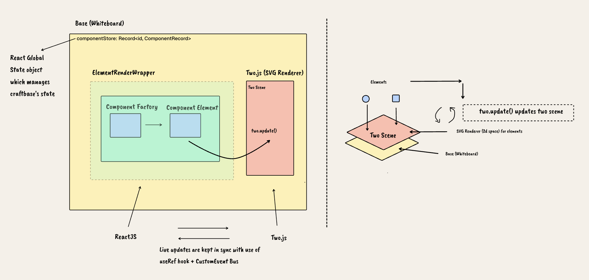

# Craftbase

Craftbase is a minimal online whiteboard. You open it and start drawing. There is no signup and no setup.

**Try it:** [craftbase.org](https://craftbase.org)


## What it is

I wanted a whiteboard that opens straight onto a blank canvas. Most tools ask you to sign in, pick a template or learn the toolbar first. Craftbase doesn't. You land on the canvas and draw.

Below is what you can do on a board:

- Draw rectangles, circles and diamonds
- Sketch freehand with the pencil and erase with the rubber
- Connect shapes with arrows. An arrow can dock onto the edge of a shape and stays attached when you move it.
- Add text anywhere, or inside a shape
- Add images (local boards only for now)
- Change stroke, fill, line width, dash style, color and opacity
- Pan and zoom around an infinite canvas
- Undo and redo
- Share a board with a link

Live collaboration is built but turned off behind a flag. I am still hardening it. Once it is on, you can share a board and draw on it together in real time.

I work on this mostly on weekends. So expect the occasional bug. If you hit one, or want a feature, [open an issue](https://github.com/craftbase-org/craftbase/issues). I read all of them.

## History

I released the first alpha of Craftbase in 2022. You can see the [LinkedIn post](https://lnkd.in/p/dewZWSsY) from back then.

My early motivation came from [Excalidraw](https://excalidraw.com), [tldraw](https://www.tldraw.com) and [Whimsical](https://whimsical.com). Using them is what got me started on building my own whiteboard.

## How it's built



The canvas is rendered with [two.js](https://github.com/jonobr1/two.js), a 2D drawing library by [Jono Brandel](https://github.com/jonobr1). Two.js draws the scene. React handles the UI and state around it.

The main component is the `Board`. It owns the canvas, the sidebar and the floating toolbar. Rendering goes through this chain:

```
Board → Canvas → ElementRenderer → Component Element → Component Factory
```

`Canvas` has the rendering logic and the input handling (mouse, drag, zoom, pan). Each element type (shape, arrow, pencil stroke) has two parts:

- **Factory.** Produces the element's template definition. Lives in `src/factory/`.
- **Component.** A React component that mounts the element into the scene and attaches its event listeners. Lives in `src/components/elements/`.

State is shared through React Context (`BoardContext`). There is no global store.

**Stack:** React, TypeScript, Vite, Two.js, Apollo Client and Hasura (GraphQL).

## Running it locally

This repo is the frontend. The backend is in [craftbase-hasura](https://github.com/craftbase-org/craftbase-hasura). You need both running to use the full app locally.

### Backend

Follow the setup steps in the [craftbase-hasura README](https://github.com/craftbase-org/craftbase-hasura).

### Frontend

Install dependencies:

```bash
yarn
```

Create a `.env` file in the project root. Copy the contents of `.envexample` into it.

Start the dev server:

```bash
yarn start
```

The app runs at [http://localhost:5180](http://localhost:5180) and hot-reloads as you edit.

Other scripts:

```bash
yarn build       # production build into ./dist
yarn preview     # serve the production build locally
yarn typecheck   # tsc --noEmit
yarn test        # unit tests (vitest)
yarn test:e2e    # end-to-end tests (playwright)
```

## Perf test

Numbers from before 0.8.3:

```
     1200 mixed elems (0.97 MB) | settle   3512 ms | blocking   2043 ms | svg nodes 7817 | selectable nodes 1200
     3000 mixed elems (2.43 MB) | settle  15629 ms | blocking  14242 ms | svg nodes 19517 | selectable nodes 3000
```

## Contributing

Issues and pull requests are welcome. That includes features, suggestions and bug reports. It's a weekend project, so thanks for the patience.
